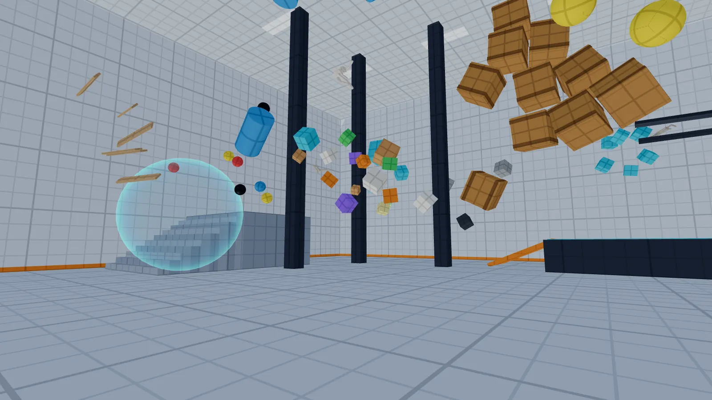
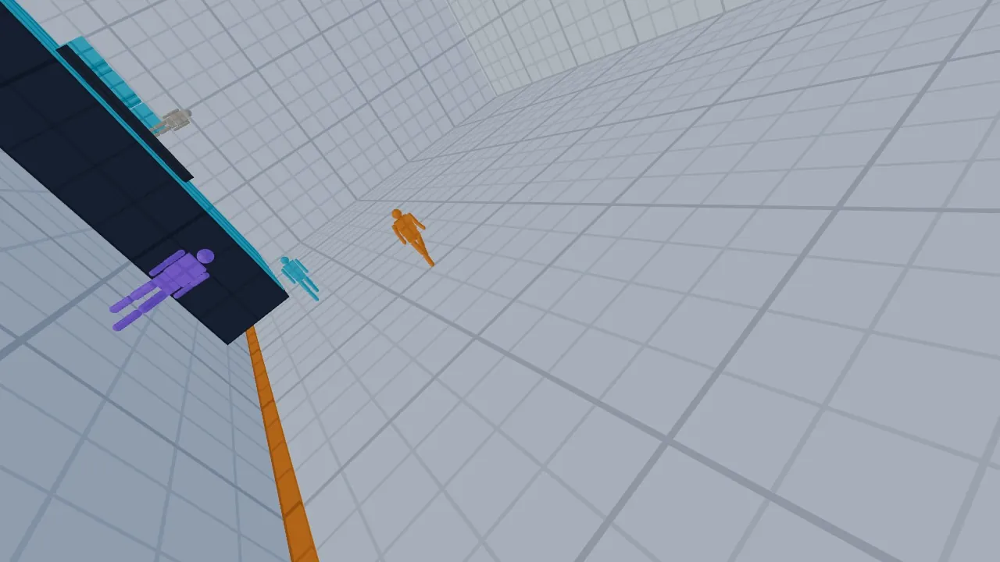
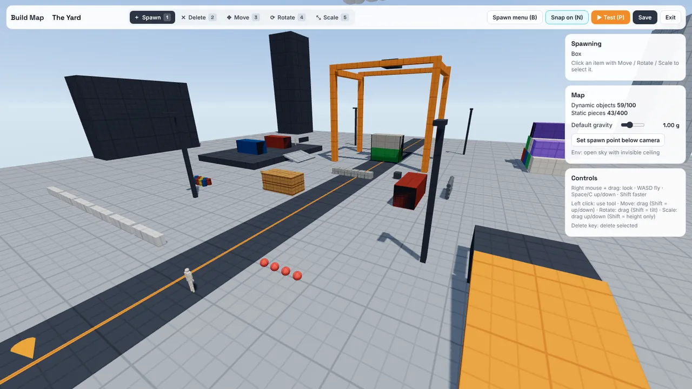

# Gravity SandBox

**Bend gravity. Walk on walls. Move anything with your mind.**

Gravity SandBox is a free first-person physics sandbox. Every object has its own gravity, and you control it: make a crate fall upward, switch off gravity for the whole room, walk across the ceiling, drop bubbles of zero-g or throw furniture with telekinesis. Play alone, or invite up to four friends and break physics together.

▶ **Play in your browser:** <https://sandbox-gravity.netlify.app>
⬇ **Download for Windows or Linux:** [latest release](https://github.com/KoC-Stellare/gravity-sandbox/releases/latest)

---

## What it is

A sandbox, not a level-based game. There are no scores, timers or missions. You get:

- **Seven gravity powers** that combine with each other (keys 1–7)
- **Four handmade maps**: The Lab and The Apartment (closed rooms), The Yard and The Atrium (open sky)
- **Build Map**, an editor to make your own playgrounds, save them and share them
- **Multiplayer rooms** for up to five players, with friends, invites and a small chat
- **A guided tutorial**, a How to play page and first-time tips

### The seven powers

| Key | Power | What it does |
| --- | --- | --- |
| 1 | **Object gravity** | Give one object its own gravity: any direction, 0–10 g, mass ×0.1 to ×100 |
| 2 | **Area scan** | Grow a sphere and change everything inside it at once |
| 3 | **World gravity** | Turn the whole map: zero-g, Moon, Mars, Earth, 3 g, 10 g, or "down is where I look" |
| 4 | **Body gravity** | Walk on the wall or ceiling you aim at; stronger gravity flips you faster |
| 5 | **Bubbles** | Zones with their own gravity: zero-g, a direction, pull in or push out |
| 6 | **Attraction** | Link objects and they pull on each other with Newton's F = G·m₁·m₂/d² |
| 7 | **Telekinesis** | Grab, throw, push, pull, rotate, crush and expand; lifts up to 350 kg |

Every power works on everything: crates, furniture, bubbles and other players (grab a friend and they ragdoll).

## How it works

- **Real physics.** The game uses the [Rapier](https://rapier.rs) physics engine. Its built-in gravity is switched off: 120 times a second the game works out the gravity of every single object (its own setting, then any bubble it is in, then the world), adds attraction and telekinesis forces, and applies them. That is why every object can fall in a different direction.
- **3D graphics** with [three.js](https://threejs.org): clean, flat-shaded low-poly style, drawn in the browser with WebGL 2.
- **Multiplayer.** The host's computer runs the physics for everyone and streams the world to the other players 20 times a second, directly between computers (WebRTC). [Supabase](https://supabase.com) is only used to find each other, for accounts, friends and saved maps.
- **One game, three ways to play.** The same code runs as a website, as an installable web app, and as a desktop program for Windows and Linux ([Electron](https://www.electronjs.org)). Accounts, friends, rooms and maps are shared between all of them.
- **Feedback.** Players can send a bug report or an idea from the game (main menu or pause menu → *Send feedback*). Messages are stored safely: anyone can send one, nobody can read them back from the game.

## Goals

- **Gravity you can play with**, simulated realistically enough that experiments behave the way you expect.
- **Easy to start:** no account and no install needed to play alone; a tutorial teaches every power in about five minutes.
- **Fun together:** up to five friends in a room, everyone with every power, on any map including your own.
- **Make and share:** a map builder that turns players into level designers.
- **Runs everywhere a keyboard and mouse are:** browser, Windows and Linux, with the same account.

## Install and play

### In the browser (Windows, macOS, Linux)

1. Open <https://sandbox-gravity.netlify.app> in a recent **Chrome, Edge or Firefox** on a desktop computer.
2. Click the game to capture the mouse, and play. No account is needed for singleplayer.
3. Optional: in Chrome or Edge, click the **Install** icon at the right of the address bar to open it in its own window like an app.

### On a PC: Windows

1. Download **`GravitySandBox-Setup.exe`** from the [latest release](https://github.com/KoC-Stellare/gravity-sandbox/releases/latest).
2. Run it. If Windows says *"Windows protected your PC"*, click **More info → Run anyway** (the game is not code-signed yet).
3. Start **Gravity SandBox** from the Start menu or the desktop shortcut.

Prefer no installer? Download **`GravitySandBox-Windows.zip`**, unzip it anywhere and run `Gravity SandBox.exe`.

### On a PC: Linux

1. Download **`GravitySandBox-Linux.AppImage`** from the [latest release](https://github.com/KoC-Stellare/gravity-sandbox/releases/latest).
2. Make it executable once: right-click → *Properties* → *Allow executing file as program*, or run `chmod +x GravitySandBox-Linux.AppImage`.
3. Double-click it to play. It runs on most 64-bit distributions (Ubuntu 22.04, Fedora 38 or newer).

The desktop app starts without internet (singleplayer works offline), toggles fullscreen with **F11** or **Alt+Enter**, and tells you when a new version is available.

### Requirements

- Keyboard and mouse
- A graphics card with WebGL 2 (most from 2014 on), 4 GB RAM
- Internet only for accounts and multiplayer

## Controls

All keys can be changed in Settings.

| Key | Action |
| --- | --- |
| W A S D, mouse | Move, look |
| Space / C | Jump / crouch (in zero-g: up / down) |
| Shift | Sprint |
| 1–7 or mouse wheel | Choose a power |
| Left click / right click | Use the power / undo or alternate |
| Q | Power settings (direction, strength, mass, presets) |
| F | Apply current settings to the aimed bubble or object |
| R (hold) + mouse | Rotate the object you are holding |
| Z / X | Crush / expand (mass follows size) |
| G | Go limp (ragdoll) / stand up |
| Backspace (hold 1 s) | Reset all gravity in the room |
| Tab (hold) / Enter | Players and room code / chat |
| Esc | Pause menu |

**Build Map:** keys 1–5 for Spawn, Delete, Move, Rotate, Scale; **B** spawn menu, **P** test the map, **N** grid snap; right mouse + drag to look, W A S D to fly.

**Multiplayer:** choose a map → **Host room**, then share the six-letter code or the invite link (Esc menu), or invite friends from the Friends list. The host's computer runs the physics, so the player with the strongest PC and connection should host. A few strict networks (schools, offices, some mobile hotspots) block direct connections; if a friend can't join, try another network.

## Feedback and bugs

Use **Send feedback** in the game, or open an issue on [GitHub](https://github.com/KoC-Stellare/gravity-sandbox/issues).

## For developers

Everything needed to run, deploy and release the project (Netlify, Supabase, the desktop builds, the folder layout) is in [docs/DEVELOPMENT.md](docs/DEVELOPMENT.md).

## Credits

- [three.js](https://threejs.org): MIT License
- [Rapier](https://rapier.rs) physics by Dimforge: Apache License 2.0 (bundled build from [lo-th/phy](https://github.com/lo-th/phy), MIT)
- [Supabase JS](https://github.com/supabase/supabase-js): MIT License
- [Electron](https://www.electronjs.org): MIT License (desktop app)
- Fonts: Space Grotesk and Inter: SIL Open Font License
